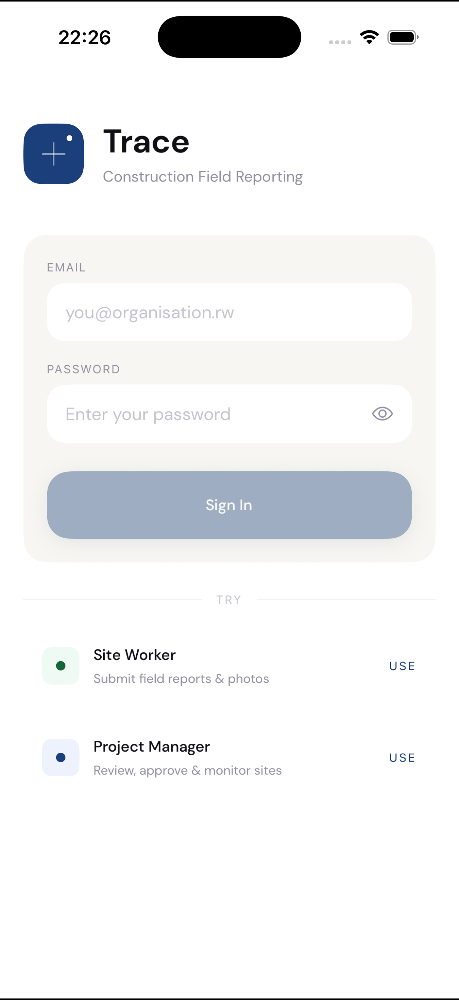
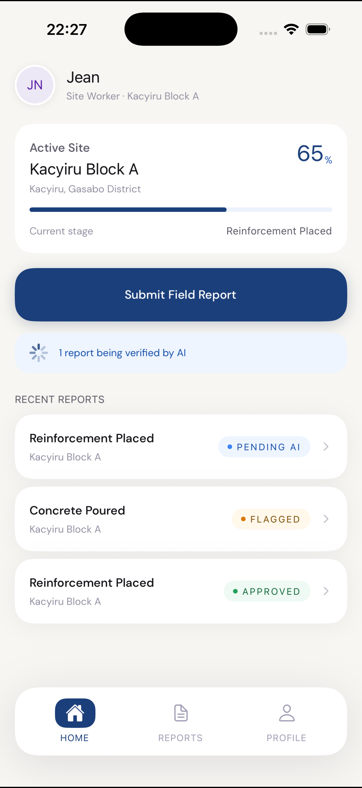
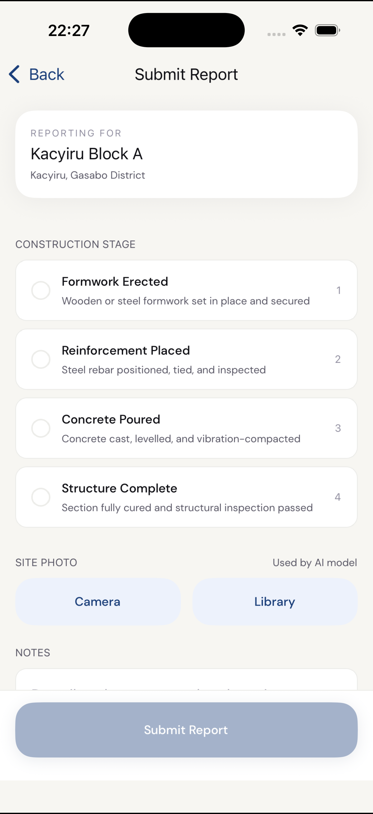
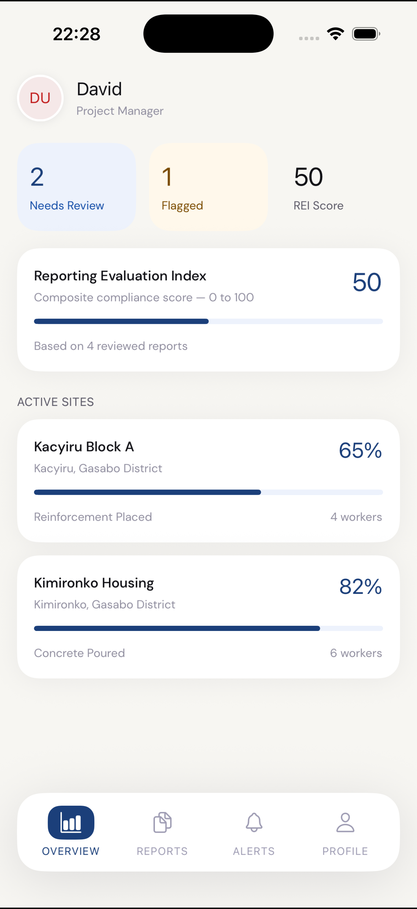
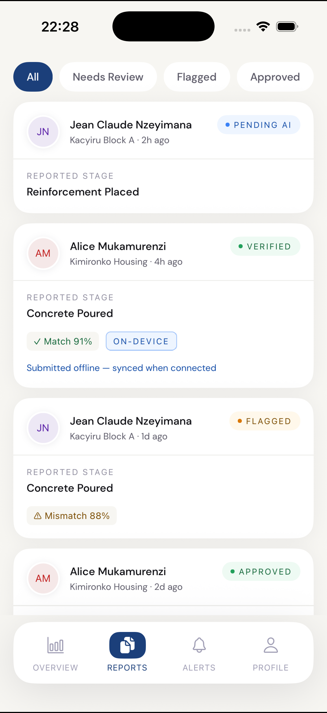
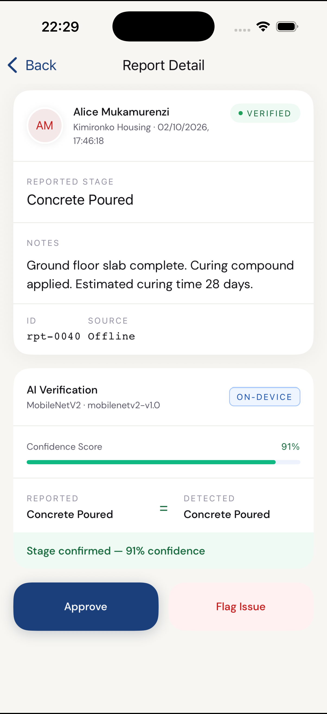

# Trace — Construction Field Reporting & AI Verification

**ALU Pre-Capstone 2025** · Edwin Bayingana (`e.bayingana@alustudent.com`) · Supervisor: Kevin Sebineza

> A mobile-first prototype for construction site field reporting with on-device AI verification of construction stages. Workers submit photo reports from the field; a MobileNetV2 classifier (simulated in this prototype) instantly cross-checks the declared stage against the captured image. Project managers get a live feed of verified and flagged reports with one-tap approve/reject.

**GitHub:** https://github.com/BayinganaEdwin/trace-field-reporting

---

## Screens & Features

| Screen           | Role    | Description                                                  |
| ---------------- | ------- | ------------------------------------------------------------ |
| Login            | Both    | Demo account tiles: tap to fill credentials                  |
| Worker Home      | Worker  | Site progress card, Submit CTA, recent reports               |
| Submit Report    | Worker  | Stage selector, camera/library photo, AI verification notice |
| Report Detail    | Worker  | Full report view with AI confidence card                     |
| My Reports       | Worker  | Full history with status filters                             |
| Manager Overview | Manager | REI score, flagged count, site summaries                     |
| Reports Feed     | Manager | Filterable feed: All / Needs Review / Flagged / Approved     |
| Report Detail    | Manager | Approve or flag with optimistic update                       |
| Alerts           | Manager | Live notification feed derived from report state             |
| Profile          | Both    | Stats, preferences, sign out                                 |

### Prototype behaviour

| Feature           | Behaviour                                                                                  |
| ----------------- | ------------------------------------------------------------------------------------------ |
| Report submission | Returns immediately; status animates `uploading → pending → verified / flagged` over ~3.5s |
| AI verification   | 85% match probability; confidence 86–97% on match, 70–89% on mismatch                      |
| Approve / Flag    | Optimistic update (instant UI) confirmed after ~700ms simulated delay                      |
| Pull-to-refresh   | Re-fetches mock data with a 600ms simulated delay                                          |
| Offline badge     | Shown on reports with `isOfflineSubmission: true`                                          |
| REI Score         | `(approved / reviewed) × 100`, updates live as you approve reports                         |

---

## Tech Stack

| Layer                      | Technology                                                         |
| -------------------------- | ------------------------------------------------------------------ |
| Mobile framework           | React Native 0.74 + Expo SDK 51                                    |
| Language                   | TypeScript (strict mode)                                           |
| Navigation                 | `@react-navigation/native-stack` + `@react-navigation/bottom-tabs` |
| Font                       | DM Sans 400/500/600/700 via `@expo-google-fonts/dm-sans`           |
| Camera                     | `expo-image-picker`                                                |
| Haptics                    | `expo-haptics`                                                     |
| State                      | React Context (`ReportsProvider`)                                  |
| AI model (production)      | MobileNetV2 —> TF Lite on-device + server full-precision           |
| Backend (not in prototype) | Node.js / Express + PostgreSQL                                     |

---

## Project Structure

```
Trace/
├── App.tsx                          # Entry: font loading, SafeAreaProvider, providers
├── index.js                         # Expo entry point (registerRootComponent)
├── app.json                         # Expo config (name: Trace, slug: trace)
├── src/
│   ├── theme/
│   │   ├── colors.ts                # Warm-cream palette + semantic status tokens
│   │   ├── typography.ts            # DM Sans scale + text variant definitions
│   │   └── spacing.ts               # 4pt grid, radii, border widths, layout constants
│   ├── types/
│   │   └── index.ts                 # Domain types (Report, Site, User) + nav param lists
│   ├── data/
│   │   ├── mockData.ts              # Seed data: users, sites, pre-seeded reports
│   │   └── mockService.ts           # API simulation with 3-phase optimistic updates
│   ├── hooks/
│   │   └── useReports.tsx           # Central store via React Context
│   ├── components/
│   │   ├── ui/                      # Typography, Button, Card, Badge, Avatar, ProgressBar
│   │   ├── layout/                  # Screen, FloatingTabBar, SectionHeader, EmptyState
│   │   └── report/                  # ReportCard, StageSelector, AIVerificationCard
│   ├── navigation/
│   │   ├── RootNavigator.tsx        # Login → WorkerApp | ManagerApp
│   │   ├── WorkerNavigator.tsx      # Tabs (Home, Reports, Profile) + stack screens
│   │   └── ManagerNavigator.tsx     # Tabs (Overview, Reports, Alerts, Profile) + stack
│   └── screens/
│       ├── auth/
│       │   └── LoginScreen.tsx
│       ├── shared/
│       │   └── ProfileScreen.tsx    # Shared between Worker and Manager
│       ├── worker/
│       │   ├── WorkerHomeScreen.tsx
│       │   ├── SubmitReportScreen.tsx
│       │   ├── WorkerHistoryScreen.tsx
│       │   └── WorkerReportDetailScreen.tsx
│       └── manager/
│           ├── ManagerHomeScreen.tsx
│           ├── ReportsFeedScreen.tsx
│           ├── ReportDetailScreen.tsx
│           └── NotificationsScreen.tsx
```

---

## Environment Setup

### Prerequisites

- Node.js ≥ 18
- npm ≥ 9
- [Expo Go](https://expo.dev/go) installed on your iOS or Android device, **or** Xcode (iOS Simulator) / Android Studio (Android Emulator)

### Install & Run

```bash
# Clone the repo
git clone https://github.com/BayinganaEdwin/trace-field-reporting.git
cd trace-field-reporting

# Install dependencies
npm install

# Start the development server
npx expo start
```

Then:

- **Physical device** — scan the QR code with Expo Go
- **iOS Simulator** — press `i` in the terminal
- **Android Emulator** — press `a` in the terminal

### Demo accounts

| Role            | Email            | Password |
| --------------- | ---------------- | -------- |
| Site Worker     | worker@trace.rw  | any      |
| Project Manager | manager@trace.rw | any      |

Both accounts are pre-filled via the tap-to-use tiles on the login screen.

---

## Designs

### App Screens

| Login                              | Worker Home                                    | Submit Report                                      |
| ---------------------------------- | ---------------------------------------------- | -------------------------------------------------- |
|  |  |  |

| Manager Overview                                     | Reports Feed                                     | Report Detail                                      |
| ---------------------------------------------------- | ------------------------------------------------ | -------------------------------------------------- |
|  |  |  |

### Key Design Decisions

- **Warm off-white canvas** (`#F7F6F2`) — feels grounded and tactile, not generic iOS gray
- **Floating curved tab bar** — pill-shaped with filled active-state indicator
- **Status badges with dot indicators** — pill-shaped, no borders; dot colour encodes state at a glance
- **Optimistic updates** — every action reflects instantly in the UI; the simulated AI verification animates through three phases to demonstrate the real-world flow
- **DM Sans** — geometric, legible at small sizes, Apple-adjacent without being a system font copy

---

## Deployment Plan

### Phase 1 — Prototype (current)

- Expo Go distribution via QR code for supervisor demo and user testing
- All data is mocked in `src/data/mockService.ts`; no backend required

### Phase 2 — MVP (capstone semester)

| Component                | Technology                          | Notes                                           |
| ------------------------ | ----------------------------------- | ----------------------------------------------- |
| Mobile app               | EAS Build → `.ipa` + `.apk`         | Standalone builds via Expo Application Services |
| AI inference (on-device) | TensorFlow Lite (MobileNetV2)       | Bundled `.tflite` model, runs offline           |
| AI inference (server)    | TensorFlow Serving on GCP Cloud Run | Full-precision fallback when online             |
| REST API                 | Node.js / Express on Railway        | JWT auth, PostgreSQL via Supabase               |
| File storage             | Supabase Storage                    | Compressed site photos, ~200KB target per image |
| Offline sync             | Expo SQLite + background task       | Reports queue locally, sync on reconnect        |

### Phase 3 — Production

- Formal app store submission (Google Play / Apple TestFlight)
- CI/CD via GitHub Actions + EAS Build triggers on `main` push
- Monitoring via Sentry (crash reporting) + PostHog (usage analytics)

---

## Connecting the Real Backend

Every function in `src/data/mockService.ts` maps 1:1 to a REST endpoint.
Replace each function body with the equivalent `fetch()` call — the hook and all screen interfaces stay unchanged.

```typescript
// mockService.ts (current — mock)
export async function fetchReports(): Promise<Report[]> {
  await delay(600);
  return [...MOCK_REPORTS];
}

// mockService.ts (production swap)
export async function fetchReports(): Promise<Report[]> {
  const res = await fetch(`${API_BASE}/reports`, { headers: authHeaders() });
  return res.json();
}
```

---

## License

MIT — prototype built for academic purposes, ALU Pre-Capstone 2025.
